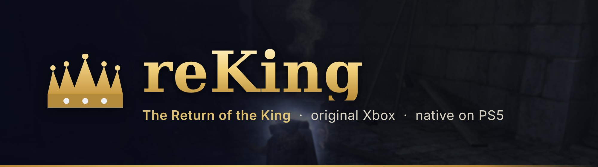
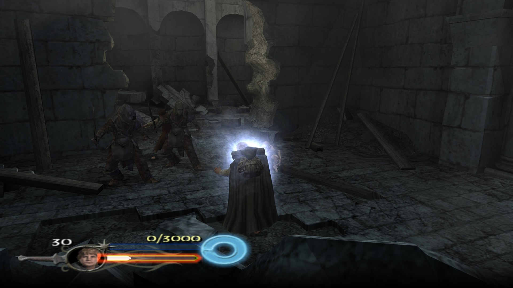
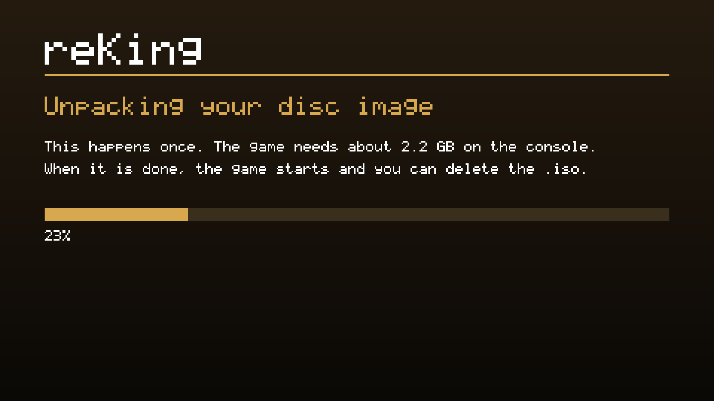

<p align="center">
  
</p>

<p align="center">
  <b>The Lord of the Rings: The Return of the King, the original Xbox version, statically recompiled<br>
  into a native app for homebrew-enabled PS5 consoles.</b>
</p>

<p align="center">
  <a href="../../releases/latest"></a>
  <a href="CHANGELOG.md"></a>
  <a href="LICENSE"></a>
</p>

<p align="center">
  <a href="#install"><b>Install</b></a>
  &nbsp;·&nbsp;
  <a href="#controls">Controls</a>
  &nbsp;·&nbsp;
  <a href="#settings">Settings</a>
  &nbsp;·&nbsp;
  <a href="#reporting-a-problem">Report a problem</a>
  &nbsp;·&nbsp;
  <a href="#for-developers">Build it yourself</a>
</p>

> [!IMPORTANT]
> **Bring your own game.**
> The app is the game's program recompiled for the PS5. It contains none of the game's files: the graphics, sound,
> videos and levels come from your own disc image of the US Xbox release. Please don't ask for or share disc images
> here.

> [!CAUTION]
> **We do not support piracy.**
> Please don't use this project with pirated copies of the game.

<p align="center">
  
  <br>
  <sub>Captured on a PS5 at 3840x2160.</sub>
</p>

## What it is

The Xbox game's code is translated into C++ ahead of time and compiled for the PS5, as
[reUndr](https://github.com/bystritskiy/reUndr-ps5) does for Need for Speed: Underground. It's not an emulator: a
replacement runtime handles the original console's graphics (Direct3D 8 on Vulkan, through Mesa's RADV), sound,
input and system services.

## Highlights

- **Native 4K.** Rendered at 1080p, 1620p or 4K and output at 3840x2160, at 30 or 60 fps.
- **HD text.** Every font is redrawn four times larger with crisp edges, the dialogs' titles too. With the PC
  version's files, from its own larger fonts.
- **Sharper pictures.** The menus' full-screen pictures, the HUD (the portrait, the life bar, the ring) and the menus'
  frames are redrawn four times larger.
- **DualSense throughout.** Cross, Circle, Square and Triangle in the hints and menus, "Press OPTIONS", L2 / R2,
  PS5 in the save messages, and a PlayStation controller on the loading screens.
- **An in-game menu.** L3 + R3 at any time: picture, frame rate, field of view, draw distance, HUD placement,
  vibration, deadzones, damage and the game's cheats.
- **Skippable videos.** Every video can be skipped, and the EA and New Line logos are.
- **Two players.** Sign in a second user (a guest is enough) and play co-op on one console.
- **Disc image install.** Copy your `.iso` to the console and start the app: it does the rest.

## Requirements

- A PS5 that runs homebrew, with [ShadowMountPlus](https://github.com/drakmor/ShadowMountPlus) (it registers apps in
  `/data/homebrew`) and an FTP server.
- Your own disc image (`.iso`) of The Return of the King, **US Xbox release** (title EA-062). A full dump and a
  trimmed one, clean or media-patched, all work.
- About 2.2 GB free on the console for the game's files, plus the disc image until the first start has unpacked it
  (or keep the image on a USB drive).

## Install

1. **The app.** Download `PPSA99063-<version>.zip` from [Releases](../../releases/latest), unpack it, and copy the
   `PPSA99063` folder to `/data/homebrew/` on the console. The **reKing** tile appears on the home screen after
   about 30 seconds.
2. **Your disc.** Copy your disc image to `/data/rotk/` on the console (create the folder), or to a `rotk` folder (or
   the top) of a USB drive.
3. **Play.** Start the tile. The first start unpacks the disc image into `/data/rotk/game/`, then the game starts.
   From then on it starts straight away, and **you can delete the `.iso`**.

<p align="center">
  
  <br>
  <sub>The first start.</sub>
</p>

Already have the disc's files (`default.xbe` and the `Data` folder)? Copy them to `/data/rotk/game/` instead. If the
console has no room to unpack the image, the app plays from the `.iso` directly and says so. If the game is missing,
damaged, or another game or release, a screen says so: press Cross to close it.

**To update,** copy the new `PPSA99063` folder over the old one. Your saves, settings and the game's files in
`/data/rotk/` are kept.

## Controls

| Xbox | DualSense |
| --- | --- |
| A B X Y | Cross Circle Square Triangle |
| Black / White | R1 / L1 |
| Triggers | R2 / L2 |
| Start / Back | Options / touchpad click |
| Stick clicks | L3 / R3 |
| | **L3 + R3:** the settings menu |

Player 1 is the user who started the app. For two players, sign in a second user on the PS5 (a guest is enough) and
turn on their controller.

## Settings

Press **L3 + R3** at any time; the game stands still behind the menu. L1 / R1 change page, Cross chooses, and
Circle, Options or L3 + R3 go back to the game. Changes apply at once and are saved when you close the menu, except
those marked "(next start)".

| Page | Settings |
| --- | --- |
| **Picture** | Render resolution (1080p, 1620p, 4K), frame rate (30 or 60), V-Sync, frame rate counter, texture filtering and sharpness, smooth menus and HUD, sharper text and menus, field of view, draw distance, HUD at the screen edges, skipping videos and logos |
| **Controls** | Vibration, stick deadzone, trigger threshold |
| **Game** | Damage you take and deal, the game's own cheats |

The app's `README.txt` describes every setting.

## Your files

| Where | What |
| --- | --- |
| `/data/homebrew/PPSA99063/` | The app |
| `/data/rotk/game/` | The game's files, unpacked from your disc image at the first start |
| `/data/rotk/settings.toml` | Settings |
| `/data/rotk/hdd/` | Saves |
| `/data/rotk/shadercache/` | Compiled shaders, made as you play (safe to delete) |
| `/data/rotk/pc/Data/` | Optional: ROTK PC's Data folder, for its larger fonts and menu pictures |
| `/data/rotk/logs/` | Logs, only while `/data/rotk/logging-on` exists |

## Reporting a problem

Open an [issue](../../issues): say what you were doing, what you expected and what happened, with a screenshot if you
can. To get a log, create an empty file `/data/rotk/logging-on` on the console and start the game; attach the newest
`/data/rotk/logs/rotkx_*.log` and `stderr.log`, then delete `logging-on` again. **Never attach game files or disc
images.**

## For developers

Players don't need any of this: the [Releases](../../releases/latest) have the app ready to copy.

### Building

You need a Linux machine (Ubuntu 24.04; WSL 2 should do) with:

```sh
sudo apt install git cmake ninja-build clang-18 lld-18 llvm-18 llvm-18-dev zlib1g-dev python3 python3-pip patch zip
```

and Docker, for reUndr-ps5's PS5 toolchain. You also need `default.xbe` from your own disc image of the US release
(title EA-062): extract it from the `.iso` with an Xbox ISO tool such as `extract-xiso`.

```sh
git clone https://github.com/coru182/reKing.git
cd reKing
./setup.sh /path/to/default.xbe     # dependencies, then the game's code recompiled from your default.xbe
./build-ps5.sh                      # the app: build-ps5/PPSA99063-<version>.zip
```

`setup.sh` downloads the pinned dependencies into `deps/` and builds reUndr-ps5's PS5 toolchain with its own scripts
(PayloadSDK, Mesa RADV for the PS5, libc, compiler-rt, the packaging tool), about 20 minutes the first time. With a
built reUndr-ps5 checkout already at hand, pass it: `REUNDR=/path/to/reUndr-ps5 ./setup.sh ...` (and the same
`REUNDR=` for `build-ps5.sh`).

At start the app checks the disc's `default.xbe` against the one it was built from: the same bytes, or the same
release with a few bytes of code changed (a media-patched or clean dump, `ps5/xbe_match.h`).

### Your own home screen art

The tile is a plain crown by default. To use your own pictures (a square image for the tile, a 16:9 one for the
background):

```sh
pip install numpy pillow
python3 tools/mkart.py my-icon.jpg my-background.png art/                # optionally --crop x0,y0,x1,y1
./build-ps5.sh package
```

`art/` is left out of git; `build-ps5.sh` puts its `icon0.png`, `pic0.dds` and `pic1.dds` in the app.

The loading help screen's controller can be your own picture too: a front view of a controller on a white or
transparent background, cut out and placed where the Xbox one was, with the same teal glow.

```sh
python3 tools/mkcontroller.py --image my-controller.png     # writes art/controller.png; --preview screen.png to look
./build-ps5.sh
```

### Making a release on GitHub

As with reUndr, players never need a `default.xbe`: they download the app from **Releases** and use their own
`.iso`. Only whoever makes a release builds it from their own disc, once per version:

1. Set `VERSION` in `build-ps5.sh` (and `contentVersion` in `package/sce_sys/param.json`), then build as above.
2. On GitHub, **Releases > Draft a new release**: a tag such as `v1.0.2`, the title `reKing 1.0.2`, the text of
   `.github/release-notes.md`, and attach `build-ps5/PPSA99063-<version>.zip`. **Publish release.**

Or let GitHub build it: the **Build reKing** workflow (Actions tab) does both steps on GitHub's machines, from a
`default.xbe` it downloads from the repository secret `XBE_URL` (a private direct-download link, for example a
Dropbox link ending in `?dl=1`; optionally `XBE_SHA256` with its checksum). Secrets never appear in the logs, and
workflows from forks don't get them. **Actions > Build reKing > Run workflow**; tick "Publish the release" to publish
it straight away, otherwise it is a draft only you see. A run takes roughly half an hour, plus about 20 minutes when
the PS5 toolchain isn't kept yet. "Only the PS5 toolchain" prepares that part without a `default.xbe`.

### How it fits together

- [Athelas](https://github.com/Shagg88/Athelas) 1.8.2 by Shagg: The Return of the King's Xbox port (its hooks,
  settings, menus, fonts, button pictures) and the SDK it ships, built on
  [XboxXBE-Recomp](https://github.com/TGP482/XboxXBE-Recomp) by TGP482 (the recompiler and the Xbox runtime: kernel,
  Direct3D 8 on Vulkan, DirectSound).
- `patches/athelas-ps5.patch`: the changes to them for the PS5: guest memory on 16 KiB pages, threads, the Vulkan
  surface on VideoOut, a logging switch, and the PlayStation wording and button pictures.
  `patches/media-patched-xbe.patch` leaves out the disc check's hook for a media-patched `default.xbe` (setup.sh
  decides).
- `ps5/`: the PS5 host: the entry point, the first start (the disc image unpacked, its screens), the app shell and
  settings, DualSense input (libScePad), sound (sceAudioOut), the in-game menu (Dear ImGui), the PS5 wording of the
  game's text, and POSIX calls the PS5 doesn't allow from an app. `ps5/art/controller.svg` is the help screen's
  PlayStation-layout controller (`tools/mkcontroller.py` makes the picture the app carries).
- [reUndr-ps5](https://github.com/bystritskiy/reUndr-ps5) by bystritskiy: the pinned PS5 toolchain (mihawk-99's
  PS5_PayloadSDK and PS5_Vulkan with Mesa RADV), its link recipe and packaging tool, and the parts of its PS5 host
  this one follows.
- [glslang](https://github.com/KhronosGroup/glslang) 15.4.0 compiles the game's shaders at run time (from HLSL);
  Mesa keeps the compiled ones in `/data/rotk/shadercache`.

## Credits

Made by [coru182](https://github.com/coru182), with Claude (Anthropic). Built on the work of:

- **The game:** EA Redwood Shores, who made The Return of the King, and Electronic Arts, who published it; Hypnos
  Entertainment, who made its PC version (whose larger fonts and menu pictures the optional sharper text reads). And
  J.R.R. Tolkien, and New Line Cinema's films, for the world it's set in.
- **[Athelas](https://github.com/Shagg88/Athelas) by Shagg:** The Return of the King's Xbox port (its hooks,
  settings, menus, sharper text, PlayStation button pictures and ROTK Fix compatibility) and the SDK this builds on.
- **[XboxXBE-Recomp](https://github.com/TGP482/XboxXBE-Recomp) by TGP482:** the static recompiler and the Xbox
  runtime (kernel, Direct3D 8 on Vulkan, DirectSound, XAPI).
- **[XenonRecomp](https://github.com/hedge-dev/XenonRecomp) by hedge-dev:** the overridable function layout and
  instruction hooks the recompiler follows; **[Zydis](https://github.com/zyantific/zydis) by zyantific:** the
  disassembler it reads the game's code with.
- **[reUndr-ps5](https://github.com/bystritskiy/reUndr-ps5) by bystritskiy:** the PS5 port this one is modelled on:
  the pinned toolchain, the link recipe, the packaging tool, the parts of its PS5 host this one follows, and the
  first start's disc image unpacking and progress screen (adapted from its `disc_image.c` and `screen_ps5.c`).
- **[PS5_Vulkan](https://github.com/mihawk-99/PS5_Vulkan), [PS5_Mesa](https://github.com/mihawk-99/PS5_Mesa) and
  [PS5_PayloadSDK](https://github.com/mihawk-99/PS5_PayloadSDK) by mihawk-99:** Vulkan on the PS5: Mesa's RADV with a
  PS5 winsys and VideoOut, and the payload SDK's platform layer.
- **[ps5-native-app-boilerplate](https://github.com/blackbearreloaded/ps5-native-app-boilerplate) by
  BlackBearReloaded:** the ELF converter, the fake-signed SELF writer and the clean-room `libc.prx` (through
  PS5_Vulkan).
- **[ps5-payload-dev/sdk](https://github.com/ps5-payload-dev/sdk) by John Törnblom:** the public PS5 headers, sysroot
  and toolchain.
- **[Mesa](https://gitlab.freedesktop.org/mesa/mesa)** (RADV, ACO, NIR, with AMD's AddrLib) and
  **[LLVM / Clang](https://github.com/llvm/llvm-project)**.
- **[glslang](https://github.com/KhronosGroup/glslang)** and the Vulkan headers (Khronos Group),
  **[Dear ImGui](https://github.com/ocornut/imgui)** (Omar Cornut), **[toml++](https://github.com/marzer/tomlplusplus)**
  (Mark Gillard), **[stb](https://github.com/nothings/stb)** (Sean Barrett), **[zlib](https://zlib.net/)** (Jean-loup
  Gailly and Mark Adler) and **Liberation Sans** (SIL Open Font License).
- **On the console:** [ShadowMountPlus](https://github.com/drakmor/ShadowMountPlus) by drakmor,
  [ftpsrv](https://github.com/ps5-payload-dev/ftpsrv) by ps5-payload-dev, and the PS5 homebrew scene whose jailbreak
  and loaders run it.

## Licence

This repository's own code is GPL-3.0 (`LICENSE`). Its patches change Athelas and XboxXBE-Recomp, which are MIT; the
app you build also contains Dear ImGui, toml++, glslang, Mesa, and the PS5 toolchain, whose link recipe and platform
library are GPL-3.0-or-later. `package/licenses/` has every licence and `package/licenses/NOTICE.txt` the details.
The game, its assets and the code recompiled from it belong to their owners and are covered by none of this.

## Legal notice

This is an unofficial, non-commercial fan project, independent of the upstream authors and rights holders. The game and
"The Lord of the Rings: The Return of the King" belong to their rights holders (Electronic Arts, New Line Cinema and
the Tolkien licensors). Xbox is a trademark of Microsoft Corporation. PlayStation, PS5 and DualSense are trademarks of Sony Interactive Entertainment
Inc. All other trademarks belong to their respective owners.
